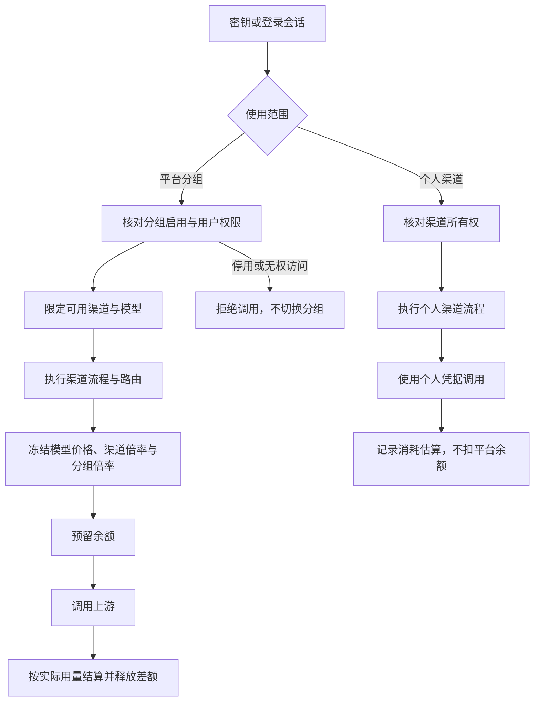

# 计费、支付、订阅与自带凭证

当前共有 35 个官方插件。以下为主要商业插件；预付计费、Stripe、易支付默认关闭。渠道管理声明 `http.dispatch` 授权；升级迁移为现有渠道配置补齐该权限。部署范围为单节点。

| 插件                         | 能力 / 页面                                                 | 行为                                                                                   |
| ---------------------------- | ----------------------------------------------------------- | -------------------------------------------------------------------------------------- |
| billing                      | `billing.credit@1`、`billing.balance@1`；用量与账单         | USD 整数微单位钱包、唯一来源账本、请求预留、结算、待核对、管理员审计调整               |
| commerce                     | `commerce.payment@1`、`commerce.entitlements@1`；充值与订阅 | 商品价格快照、订单、单次支付、周期额度、权益到期、取消续订、持久 outbox                |
| payments-stripe              | `payments.provider@1`；Stripe 支付配置                      | Checkout 单次支付和持续订阅、原始字节 Webhook 验签、异步支付、周期发放                 |
| payments-epay                | `payments.provider@1`；易支付配置                           | 多支付方式与商户、V1/V2 与 MD5/RSA 独立配置、V2 响应验签、支付回调、预付周期与手动续费 |
| byok                         | `credentials.select@1`、`credentials.resolve@1`；自带凭证   | 按用户和渠道隔离的加密 API Key / OAuth 授权、过期刷新、撤销                            |
| rate-limit                   | 流量策略                                                    | 按用户、Key、渠道聚合 RPM/TPM/并发，以及 HTTP/SSE 输出字节限速                         |
| upstream-codex               | `ai.upstream.codex@1`                                       | 官方 SIWC Responses 模式及 CLI 兼容模式                                                |
| upstream-claude-subscription | `ai.upstream.claude-subscription@1`                         | Claude OAuth Bearer 认证、Messages JSON/SSE                                            |
| upstream-antigravity         | `ai.upstream.antigravity@1`                                 | Project 请求包装、Gemini JSON/SSE、外层 response 解包                                  |

## 计费规则

1 USD = 1,000,000 微美元。Token 价格以 USD / 百万 Token 配置，支持普通输入、输出、缓存读、缓存写、1 小时缓存写、上下文阶梯及按次计价。价格填写原价，渠道倍率与使用分组倍率相乘参与最终计算。用有理数汇总后只在最终微美元边界向上取整；SQLite 事务内记录资金变动和唯一来源。非整数、负信用充值或超出 JavaScript 安全整数范围的金额会被拒绝。

Admission 按流程变换后的消息、工具和输出预算预留，使用当次冻结的价格快照。输出预算由计费策略和提供商限制共同确定；实际使用量结算后释放差额。BYOAPI/BYOSUB 请求跳过平台钱包扣费，上游使用量与费用估算保留在调用记录中。

Finalize 仅在请求完成且实际用量有效时结算。从未进入上游执行的失败释放预留；调用已开始但缺用量、取消时只有部分用量、异常退出遗留的预留进入待核对。管理员根据服务商事实填写实际费用和原因；填 0 释放预留，不自动将未知用量记作免费。

输入总量包含 Anthropic 缓存读写 Token；Gemini 输出总量包含 thoughts Token。缓存细项从输入总量中拆分计价，思考 Token 已包含在输出总量内，不重复收费。观测插件保存费用估算快照，通过 `billing.request-charges@1` 查询实际扣费、预留和核账状态；账本查询失败显示不可用，不能将未知金额当作零。钱包资金历史由服务端筛选和分页，支持本人 CSV 导出。

## 商品和支付

管理员在「支付与商业 → 商品与订阅」设置商品、实际支付币种、支付金额、到账 USD 额度和单次/周期模式。新商品使用持久化的数字自增编号，界面不再要求手工填写；历史商品继续保留原 ID。支付适配器统一在「支付方式」配置；余额和管理员身份在用户管理中调整。用户购买位于「充值与订阅」，资金明细位于「用量与账单」。CNY 商品购买 USD 额度是明确的商品定价，没有隐式换汇。已有订单和订阅使用原价格快照。Checkout 支持 `Idempotency-Key`，并发或超时重试复用原订单；付款通知先到时，不会被迟到的失败响应覆盖。

支付插件只负责支付平台协议。验签后，Commerce 核对订单、商户、金额和币种，在本库事务内写支付事实和 outbox；随后调用 `billing.payment-state@1`，在同一钱包事务内提交原始额度、累计冲减与支付冻结。投递失败定时重试，也可由管理员调用 `POST /api/plugins/official.commerce/retry`。账本先提交而 outbox 尚未标记时，重启重投不会双入账；并发更新的较新版本不会被旧任务标为已投递。单个钱包失败不会阻塞其他用户入账。普通 Event 不承担财务交付。

### Stripe

在 Stripe 支付页面直接填写商户密钥与 Webhook 签名密钥，并选择测试/正式模式；保存到支付插件的加密存储。留空保留已保存凭据。Webhook 地址：

```text
https://你的域名/api/plugins/official.payments-stripe/webhook
```

订阅事件：`checkout.session.completed`、`checkout.session.async_payment_succeeded`、`invoice.paid`、`invoice.payment_failed`、`customer.subscription.updated`、`customer.subscription.deleted`。

请求固定使用 Stripe API `2025-03-31.basil`；验签基于原始字节、HMAC-SHA256、300 秒时效和常量时间比较，支持多个 v1 签名。关键事件再次查询 Stripe 对象。兼容 Invoice 旧 `subscription` 及新 `parent.subscription_details.subscription` 字段。

单次支付只有 `payment_status=paid` 才入账，以 PaymentIntent 去重。订阅只按已付 Invoice 发放周期额度，Checkout 完成不重复发放。重复或同周期 Invoice 不二次发放；状态更新查询当前订阅，避免旧事件覆盖新状态。取消自动续订保留已付周期。

### 退款与支付争议

Stripe 处理 `refund.created`、`refund.updated`、`refund.failed`、`charge.refunded` 及 `charge.dispute.created/updated/closed/funds_withdrawn/funds_reinstated`。验签后重新查询当前退款、争议及发票支付关联，不直接用通知快照的金额或状态变更钱包。整笔退款通知会分页读取全部退款；订阅按 Invoice Payments 关联原 Invoice，兼容本地原有的发票支付 ID。

Commerce 持久保存每笔退款或争议及去重事件。通知早于支付入账时保留待匹配事实，支付到达后自动关联；充值与已确认的冲减、冻结一次性写入钱包，不先放出可花费额度。未匹配、关联不明确、币种或金额异常的记录进入管理核对；能够关联但状态异常的支付保守冻结原额度。

处理中退款及未决争议冻结对应额度；成功退款或败诉将对应额度转为账本冲减，失败退款、取消退款及胜诉/关闭争议释放冻结，已冲减的款项按服务商最新事实追加恢复账本。所有变动保留原始入账，不删除历史记录。按购买时的支付金额与 USD 到账额度比例计算，合计冲减与冻结不超过该笔原额度；商户争议费用不向用户额外扣取。余额已消费时允许产生欠额，新的预付调用继续受可用余额检查约束。

管理员在「商品与订阅 → 退款与争议」按用户、状态及记录搜索，重新核对须近期管理员认证和操作原因，写入管理审计。重新核对只读取服务商事实并同步钱包，不发起银行退款、不提交争议材料，也不自动改变 Stripe 续订计划。用户仅从自己的订单查看退款与争议；钱包区分请求预留和支付冻结，资金明细显示冲减与恢复。

易支付各平台的退款接口不统一，首期保持商户后台退款、人工核对并在用户管理中追加有原因的余额调整，不虚构自动退款支持。

当前商品是固定金额、单价格周期。优惠码、税费、试用、按比例变更、银行退款发起、Stripe 保存付款工具管理和发票 PDF 暂未实现。上述退款及争议链路已由隔离模拟服务验证，仍须使用实际 Stripe 测试商户完成事件回放后再开放收款。

协议参考：[退款对象](https://docs.stripe.com/api/refunds/object)、[争议对象](https://docs.stripe.com/api/disputes/object)、[Invoice Payments](https://docs.stripe.com/api/invoice-payment/list)。

### 易支付

在易支付页添加支付方式，可同时启用支付宝、微信支付及 QQ 钱包，也可配置多个平台或商户。每条配置拥有持久化数字自增编号、名称、独立启停、V1/V2 与 MD5/RSA 设置；可复制商户参数后切换支付类型，新增方式默认停用。用户购买时按实际方式选择，订单保存所选配置及名称，幂等键不能跨方式复用。商品、渠道和支付方式等内部配置 ID 自动生成；模型名等外部协议标识仍由管理员指定。

停用方式或关闭易支付只阻止新订单，已存在且保留配置的订单仍可接收回调。删除配置后该方式的待付款订单不能验签，建议先停用并等待订单完成。旧单配置及无方式 ID 的历史订单回调继续兼容，旧环境变量引用随升级导入加密存储。

配置 V1/V2 与 MD5/RSA。文档标准组合是 **V1 + MD5、V2 + RSA**；另外两种为兼容模式，须确认具体商户平台支持。

V1 生成 `/submit.php` 跳转；V2 POST `/api/pay/create`，携带 `method=jump`、clientip、timestamp 等字段，只接受验签后的跳转响应，不执行平台返回的 HTML/JS。RSA 使用 SHA256WithRSA / PKCS#1 v1.5；私钥签请求，平台公钥验响应/通知。MD5 按字段 ASCII 排序，排除空值/sign/sign_type，不 URL 编码签名原文，拼接商户 Key。

控制台可直接填写 MD5 商户密钥，或 RSA 商户私钥及平台公钥。插件使用 AES-256-GCM 加密存入自己的 `secrets.sqlite`，主密钥保存在同目录的 `vault.key`（权限 0600）。配置仅保存不可变的 `local:` 引用，查询配置和再次编辑均不返回密钥原文；留空保留已有值，复制支付方式复用原引用。备份必须同时保留插件数据和主密钥，修改凭证须管理员会话及近期身份确认。

`keyRef`、`privateKeyRef`、`platformPublicKeyRef` 保存加密凭据编号，页面直接填写实际密钥。宿主托管的 `secret:` 引用需要出现在 `secretRefs` 授权列表。回调：

```text
https://你的域名/api/plugins/official.payments-epay/notify?pluhub_method=<支付方式ID>
```

通知地址随订单生成。Commerce 核对回调方式与订单绑定，易支付同时核对该方式的商户与支付类型；支付流水按方式 ID 隔离，避免不同商户的交易号碰撞。只有验签成功的 `TRADE_SUCCESS` 才入账，重复通知返回 success 而不重复发放。金额严格解析为整数分并核对订单。易支付周期套餐是预付权益，没有自动续扣；用户到期重新购买。自然月/年按 UTC 日历计算并处理月底/闰年。

## BYOK 和订阅授权

通用凭据、旧引用升级及备份要求见 [凭据与参数](SECRETS.md)。以下静态连接示例中的 `secret:` 编号须替换为实际保存的编号；订阅渠道优先在账号管理页授权。

用户在「个人渠道」保存自己的上游地址、API Key 和模型映射；订阅授权在「自带订阅」中由各提供商插件管理。API Key 可绑定个人渠道，请求也可用 `x-pluhub-channel` 选择个人渠道。平台渠道使用管理员配置的上游授权，不提供用户覆盖平台凭证的接口。

个人密钥采用 AES-256-GCM 加密，AAD 绑定 ID、用户、渠道和类型。主密钥默认在首次启动生成权限 0600 的 `vault.key`；显式 `masterKeyRef` 使用宿主托管凭据，值为 32 字节 Base64。备份时保留数据库和主密钥；更换主密钥不会自动重加密旧数据。

各订阅提供商插件负责 OAuth 授权、刷新和账号占用，见 [订阅上游插件](SUBSCRIPTION_UPSTREAMS.md)。

渠道配置示例（与普通模型映射组合）：

```json
{
  "codex-plan": {
    "protocol": "codex",
    "authMode": "siwc",
    "baseUrl": "https://api.openai.com/v1",
    "keyRef": "secret:CODEX_ACCESS_TOKEN"
  },
  "codex-cli": {
    "protocol": "codex",
    "authMode": "cli",
    "baseUrl": "https://chatgpt.com/backend-api/codex",
    "keyRef": "secret:CODEX_ACCESS_TOKEN",
    "accountId": "你的账号ID"
  },
  "claude-plan": {
    "protocol": "claude-subscription",
    "baseUrl": "https://api.anthropic.com",
    "keyRef": "secret:CLAUDE_ACCESS_TOKEN"
  },
  "google-plan": {
    "protocol": "antigravity",
    "baseUrl": "https://cloudcode-pa.googleapis.com",
    "keyRef": "secret:GOOGLE_ACCESS_TOKEN",
    "projectId": "你的项目ID"
  }
}
```

订阅授权是否允许模型调用取决于实际账号和服务商，不凭模型目录推断。CLI 模式强制流式上游，非流式入口可收集后返回；自动忽略归一化后的 maxTokens/temperature，兼容客户端默认输出参数及 Anthropic 入口必填的 max_tokens。SIWC 模式保留这些参数。CLI 平台计费在 automatic/estimate 策略下按站点默认输出 Token 数估算预留、按实际上游 Usage 结算，不声明已执行输出上限；bounded 策略仍拒绝无法执行硬上限的 Token 计费请求，固定按次计费可用。

三个订阅适配器已通过本地认证头、请求包装、JSON/SSE、取消和入口组合验证；没有用户真实订阅授权，未宣称服务商实测成功。

## 限流、转换和界面

流量策略可同时设置每用户、每 Key 和各渠道的 RPM/TPM/并发。使用一分钟固定窗口；Token 先预留、完成后按真实用量修正；未知或中断保留预算，下一窗口恢复。状态存在内存，重启重置，当前不提供分布式限流。密钥上限由 Rate Limit 与全局密钥上限合并执行，取较小值；Auth 只负责授权，不再保存独立计数。

带宽单位为字节/秒，作用于 HTTP/SSE 响应体，使用 pull 背压并可取消等待，不是 Token/秒限速。宿主 Streaming Hook 可以通过公开 `RequestContext.response` 包装标准 Web Response。客户端关闭响应会中断请求信号，Finalize 后释放资源。

协议编解码由入口与上游共享同一实现，转换范围由渠道协议节点控制。订阅服务的包装由各自适配器处理。文本、工具、用量及流式范围见 [支持矩阵](PROTOCOLS.md)。

控制台按账单、订阅、支付方式和个人渠道组织业务入口。协议准入、限流、输出 TPS、自动路由和请求变换统一在渠道流程图编辑。保留可读字号、焦点样式、明暗主题及手机布局。

## 文档与参考来源

以下仅作协议/功能参考，未复制参考项目实现源码：

- [Stripe Checkout](https://docs.stripe.com/api/checkout/sessions/create)、[Webhook 验签](https://docs.stripe.com/webhooks)、[订阅事件](https://docs.stripe.com/billing/subscriptions/webhooks)、[履约](https://docs.stripe.com/checkout/fulfillment)
- [易支付 V1](https://yzf.yzfpay.com/doc/v1_legacy_api.html)、[V2 创建订单](https://ezfu.cn/doc/pay_create.html)
- [CLIProxyAPI](https://github.com/router-for-me/CLIProxyAPI)、[Sub2API](https://github.com/Wei-Shaw/sub2api)
- [OpenAI SIWC](https://developers.openai.com/siwc/quickstart)、[Codex app-server token sharing](https://developers.openai.com/siwc/token-sharing-open-source/codex-app-server)

模拟支付验证不发起真实付款。真实支付、邮件和模型调用需在有效环境中单独验收，方法及预算见 [联调说明](LIVE_TESTING.md)。现场结果保存在仓库外，不将单次联调结果作为长期兼容承诺。

## 插件边界与配置迁移

渠道插件管理模型映射、原价、渠道倍率和执行图，编辑器通过 `/api/plugins/official.ai-router/configuration` 读写自己的配置及必要的策略名称。后端按插件 Manifest 识别上游并同步密钥引用，使用配置修订号拒绝过期保存。发现的模型默认停用，完成定价及映射后启用。个人渠道保存同一份模型元数据契约，数据按拥有者隔离。

入口和上游各自调用共享协议编解码库；协议准入仍是渠道流程节点。独立 `official.protocol-converter` 和旧 `official.workflow` 已退役，旧工作流在停机升级时迁移到渠道图。Docker 启动迁移先保存完整配置副本，再移除退役插件和能力绑定，不删除插件历史数据。非 Docker 部署在停机后运行 `bun scripts/migrate-plugin-boundaries.ts CONFIG --write`。

支付适配器通过 `payments.provider@1` 声明支付方式、币种、支付模式、续订及门户能力。Commerce 按公开提供商 ID 分派调用，不按品牌名选择业务分支。订单保存续订方式；已有 Stripe 订单通过数据库迁移补齐自动续订，其余已有订单为手动续费。

Finalize 的各 Hook 独立执行，单个结算或观测错误不会阻止后续资源释放，错误由宿主统一报告。停用和启用插件先校验活动依赖和配置，再持久化并发布执行图。

## 使用分组与调用范围

「系统设置 → 渠道与路由 → 使用分组」配置名称、可用平台渠道、倍率、启停及用户权限。默认分组未配置渠道列表时覆盖全部平台渠道；其他分组显式指定渠道。分组只使用不可变 ID 绑定密钥，改名不影响绑定；停用或无权访问时拒绝调用，不自动换组。指定用户名单留空时没有用户可用。

新平台密钥绑定一个分组；个人密钥绑定自己的个人渠道。分组限制同时用于模型目录、费用试算、实际路由和自动路由候选，流程内重定向也不能越出分组渠道。平台价格为最终模型价 × 入口渠道倍率 × 分组倍率，最终价格快照保存总倍率和当时的分组名称、倍率；历史账单不随配置变化。个人上游调用只记录消耗估算；显式进入平台分组节点时，按平台规则预留并扣除余额，详见 [个人渠道](PERSONAL_CHANNELS.md)。

升级时，旧未绑定渠道的密钥进入默认分组；旧平台渠道绑定迁入相同渠道范围、仅原用户可用且倍率为 1 的分组。相同范围合并，不扩大权限；混合平台和个人绑定须先拆成两把密钥，详见 [运维迁移](OPERATIONS.md)。现有 `RequestPricing.multiplier` 仍是唯一参与金额运算的倍率，分组快照只作说明，不重复乘算。



调用在路由完成前失败且未进入计费时显示「未进入渠道／未进入计费」，不计入结算未知；已经进入资金预留的请求继续以钱包记录为准。首页首字与完成平均耗时使用同一批成功、已记录首字输出的流式请求。

实现参考：[New API 分组倍率](https://github.com/QuantumNous/new-api/blob/main/setting/ratio_setting/group_ratio.go)、[Sub2API 分组管理](https://github.com/Wei-Shaw/sub2api/blob/main/backend/internal/service/group_service.go)。
