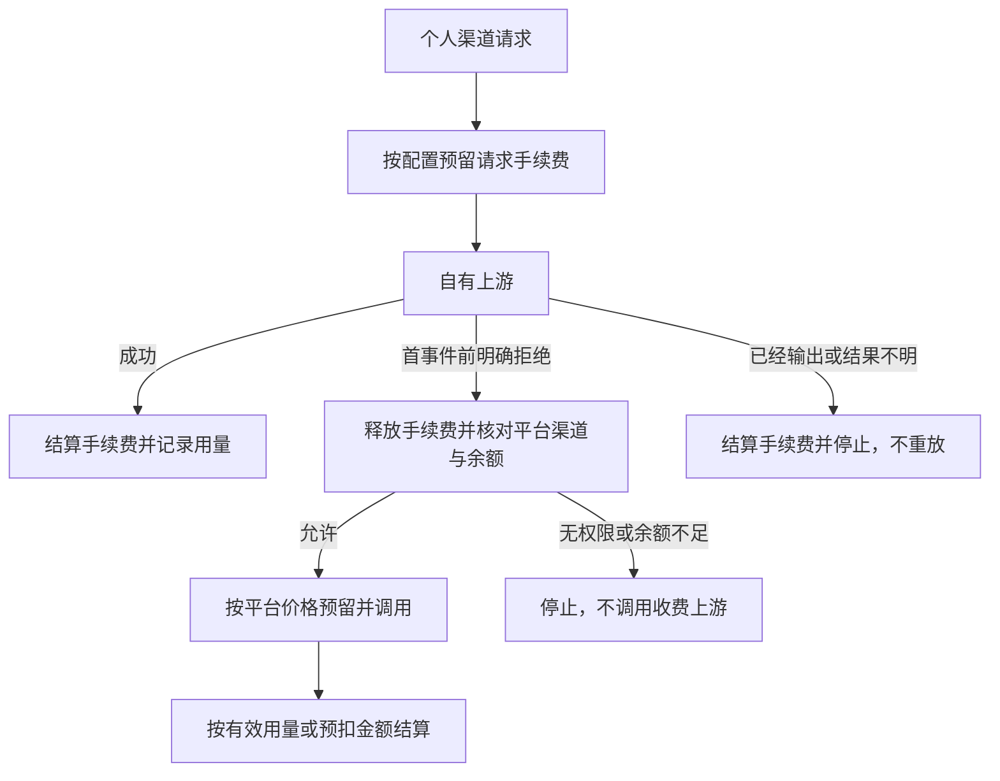

# 个人渠道与 API Key 绑定

普通用户从「个人渠道」添加上游，选择 OpenAI、Anthropic、Gemini、DeepSeek、OpenRouter、New API 或自定义预设，填写地址、密钥和模型映射。预设用于填充可编辑的连接信息，不是渠道类型。每个用户最多保存 64 个渠道，每个渠道最多 256 个模型；渠道可启停、改名、轮换密钥、删除及使用流程图组合功能。

渠道与凭证按用户隔离。上游密钥使用现有 AES-256-GCM Vault 加密，不返回给浏览器；管理写入要求控制台会话。保存采用 revision 检查，拒绝覆盖过期编辑。流程图支持条件、提示词、思考强度、输出预算、TPS、渠道内模型重定向和调用上游；个人流程不能注入其他上游连接；可通过「平台渠道」节点引用具体的平台渠道。平台自己的渠道仍由管理员维护，个人流程不读取或保存其连接凭证。

BYOAPI 可粘贴 New API 导出的连接 JSON，或使用 base_url/api_key 等常见属性填充连接。保存前即可获取模型目录，返回结果不包含密钥，只有确认保存后才创建渠道。目录查询沿用公网校验、超时与响应大小上限。

## BYOSUB 自带订阅

在「个人渠道 → 自带订阅」管理本人的 Codex、Claude、Antigravity 或 Grok 账号，只展示已安装且运行的提供商。账号加密存储、刷新、额度和连接模式统一由 [订阅上游插件](SUBSCRIPTION_UPSTREAMS.md) 管理；个人渠道只保存账号引用，与平台订阅账号隔离，管理操作限本人登录会话。

授权后点击「添加渠道」，配置提供模型，再使用同一套流程图、在线试用和 API Key 绑定。订阅凭据只发送给对应提供商的官方上游；兼容网关地址与网关 Key 应使用 BYOAPI。模型目录用于选择上游目标，不能据此推断账号实际具备调用额度。

停用或删除授权不会自动改走平台收费渠道；平台委托须通过下述显式平台渠道节点配置。个人上游成本由用户与提供商结算，平台可按配置另收请求手续费。

## 原价与消耗倍率

模型 `inputPrice` / `outputPrice` 始终表示原价（USD / 百万 Token）。可填写原价，或点击「匹配平台原价」填入同名模型的已配置原价。此操作仅补空值。

- 自动：分别以 `upstreamInputPrice / inputPrice` 和 `upstreamOutputPrice / outputPrice` 计算消耗倍率。未填写某一侧上游报价时，该侧按原价估算 1×；缺原价时倍率未知。
- 手动：有效输入/输出价格 = 对应原价 × 渠道 `consumptionMultiplier`，允许 0，默认 1。
- 调用成本（USD）= `(输入 Token × 有效输入价 + 输出 Token × 有效输出价) / 1,000,000`。调用日志按微美元四舍五入。原价目录不随倍率变化。
- 原价和有效价均为 0 时倍率显示 1×；原价 0 且上游报价非 0 时倍率显示未知，仍可按报价估算成本。价格缺失不当成免费。

New API 预设可读取公开 `/api/ratio_config`，把上游基础 Token 价格作为报价预览，用户确认应用并保存后生效，保留模型原价。转换规则为 `input = model_ratio × 2`，`output = input × completion_ratio`，不导入按次价格；公开报价不包含账号折扣、缓存和特殊服务层费用，可手动覆盖。模型目录同步与价格同步都有超时和响应体大小限制，不自动发起文本生成。

个人渠道模型费用由用户与上游服务商结算，调用记录中的成本仍用于估算上游费用。管理员可在「计费设置 → 请求计费」设置 `personalRequestFee`（USD / 次），统一向 BYOAPI 和 BYOSUB 的实际上游请求收取平台手续费；默认 0，关闭预付计费时也不收取。手续费不乘渠道倍率，不按 Token 数量变化，不覆盖用户填写的上游价格。

启用手续费后，在调用前从 PluHub 钱包预扣该固定金额；余额不足不调用上游。未执行或首事件前明确拒绝时释放预扣，安全备用切换按最终执行路径计费；已经派发的取消、断流等沿用预扣结算规则，无需等待核账。每个实际执行的个人上游请求收取一次，流程协调器不重复收费。手续费与价格在派发时保留快照，调整配置不改变在途请求的扣款。

模型详情和在线对话在手续费非零时显示金额，个人渠道费用试算返回钱包手续费。资金明细单列「请求手续费」；钱包消耗汇总包含该金额，调用记录的上游成本保持独立。平台渠道继续走既有模型计费规则。

## 密钥与路由

创建或编辑 API Key 时直接选择允许的平台渠道及本人个人渠道，可同时绑定多个渠道；未选择时仅使用平台默认路由。修改范围不需要轮换密钥，下一次请求生效。

密钥通过 `channel_ids_json` 保存直接渠道范围，使用 `PUT /keys` 编辑。客户端发送标准 `Authorization: Bearer <PluHub Key>`，不需要传凭证 ID。未指定渠道时按模型及优先级匹配，`x-pluhub-channel` 只能选择绑定范围内的渠道。

每次请求检查个人渠道所有权、启停和凭证有效性，模型权限按客户端公开名检查。无可用绑定时拒绝，不扩大到其他渠道；平台备用出口只按下述显式连线执行。平台凭据由管理员配置，个人渠道不会读取或保存这些凭据。

## 多接口组合

BYOAPI 与平台流程图的上游连接均可配置 `interfaces`。这是同一连接内的有序接口路由，不增加渠道类型。每条规则声明 `incoming` 入口协议、目标 `protocol`，可用 `models` 按映射后的上游模型精确匹配或使用 `*` 通配。配置接口组合后使用第一条匹配规则，没有匹配项时明确拒绝；没有配置组合的连接继续按其默认接口转换请求。

支持 Chat Completions、Responses、Messages 和 Gemini 任意组合。`path` / `streamPath` / `modelsPath` 相对于当前连接的 Base URL，`{model}` 会编码为路径参数；Gemini 普通和流式路径分别处理。每条规则可配置认证方式、请求头和服务商扩展参数。`{key}` 仅引用此连接的密钥，不读取客户端认证；模型、输出预算与用量采集不能被扩展参数覆盖，仍由模型映射与渠道流程决定。订阅账号不允许通过这些设置向任意 API 地址发送 OAuth 凭据。

模型发现按各规则的协议、目录路径和认证查询，并按规则匹配模型，合并重复模型的接口声明。部分接口发现失败仍返回其他接口的结果与对应错误；Chat / Responses 共享相同目录配置时合并查询。模型发现通过各物理适配器的 `ai.upstream-models.<protocol>@1` 能力读取其已授权密钥引用，路由器不直接读取服务商密钥。

个人接口路由始终继承本人渠道的凭据与公网边界，不接受其他渠道连接或凭据覆盖。修改接口组合不合并平台/其他个人渠道的模型映射，也不改变 API Key 的渠道授权。

## 公网连接边界

个人渠道禁止 URL 中的用户名、密码、查询串和片段；默认仅允许公网 HTTP(S)。传输层在实际连接的 DNS 解析中检查所有地址，阻止本机、内网、链路本地、保留地址及 IPv6 过渡/映射地址，不跟随重定向。管理员可通过 BYOK 插件 `allowedPrivateOrigins` 配置精确来源例外，用于受信任私有上游或本地模拟测试。该设置不向用户开放；生产默认无例外。

数据随 `/data` 备份，包括 BYOK SQLite 与 `vault.key`。升级保留个人渠道、自带订阅和对应 Key 的渠道绑定；已删除的平台渠道凭证及其 Key 绑定不再可用。

参考 AxonHub 的渠道内模型映射与 API Key 渠道限制边界：

- https://github.com/looplj/axonhub/blob/unstable/docs/en/guides/channel-management.md
- https://github.com/looplj/axonhub/blob/unstable/docs/en/guides/api-key-profiles.md
- https://docs.newapi.pro/zh/docs/guide/console/settings/rate-settings

高级自定义接口组合参考：https://github.com/QuantumNous/new-api/blob/main/relaykit/dto/channel_settings.go（独立实现，未复制源码）。

## 平台渠道与备用切换

在个人渠道流程图添加「平台渠道」，选择平台渠道和该渠道的公开模型；模型留空时使用当前模型映射的目标模型。该节点可直接作为终点，也可接在条件分支中。保存和实际调用均检查目标渠道，渠道停用后不能继续调用。

选中「调用上游」节点，把「失败后切换」指向平台渠道节点。只有首个标准化事件之前的明确认证、权限、模型不存在、限额或暂不可用拒绝才切换；请求参数错误、未知网络结果或开始输出后的失败不重放。一次调用只进行这一条显式备用切换，不擅自扩大到其他渠道。

个人主渠道按配置收取请求手续费，不预扣备用平台的模型费用。切换到平台时，重新解析该渠道的模型、协议与价格，按平台入口渠道倍率预留余额；余额不足则停止，不调用收费上游。实际扣费和日志以最终执行路线为准，日志保留失败尝试。全局用户/密钥请求数及已经过的节点不会因切换重复计数，新渠道的节点限制仍生效。已经预留的失败尝试只有在明确未生成时才释放；网络不明和中途失败也会结算，有有效用量时按用量，否则按预扣金额。

渠道「测试请求」通过标准网关入口执行，同样检查限流、计费和调用记录。包含平台渠道的测试可能扣除平台余额。路径预览只读取草稿路径，不调用提供商或扣费；带备用路线的费用试算不能承诺固定最终金额。

