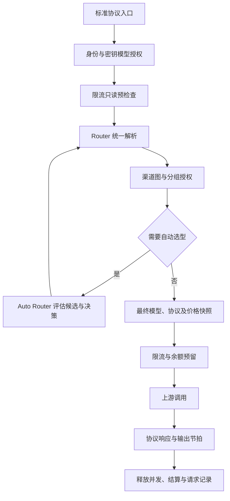

# 插件架构与职责

PluHub 以插件为安装和发布单位，以公开能力接口为协作边界。当前有 35 个官方插件。内核管理依赖、权限、生命周期和请求快照，业务数据由所属插件维护；模块化不要求拆成多个进程或部署多个数据库。

## 数据与行为归属

| 组件                       | 负责                                                | 协作边界                                                             |
| -------------------------- | --------------------------------------------------- | -------------------------------------------------------------------- |
| Kernel / Runtime / Engine  | 插件加载、权限、执行图、取消与排空                  | 不依赖 AI、计费或支付领域契约                                        |
| Control / CLI              | 配置、安装依赖解析、包操作与管理 API                | CLI 和网页共用安装解析器；配置变更一次发布                           |
| Console                    | 页面装配、导航、门户、站点初始化                    | 使用公开 API，不复制其他插件的业务数据                               |
| Users                      | 用户资料、组织归属、角色和偏好                      | 提供用户查询，不拥有密码或密钥                                       |
| Auth                       | 密码、会话、API 密钥、验证与安全历史                | 查询 Users；仅校验身份和密钥模型授权，不维护请求限流计数             |
| Mailer / 人机验证          | 邮件传输 / 第三方验证协议                           | Auth 决定验证用途、接收人和账号语言                                  |
| AI Router                  | 平台渠道、模型映射、使用分组、路由解析与执行编排    | 执行、候选评估和费用试算共用解析器，不保存个人凭证                   |
| Auto Router                | 候选筛选、难度决策、模型和思考强度选择              | 通过 Router 解析候选，仅提供 `ai.auto-routing@1`，不伪装成生成适配器 |
| Rate Limit                 | 用户、密钥、渠道节点的请求数、Token、并发与带宽限制 | 密钥自带上限与全局上限取较小值，共用一个密钥计数桶                   |
| Token Speed                | 输出内容交付节拍和同渠道模型总速度                  | 使用分词器；仅提供 `ai.output-pace@2`，不负责请求数或资金预算        |
| ingress-* / upstream-*     | 客户端协议接收和响应 / 提供商调用与响应转换         | 共用中间表示；入口与上游独立组合                                     |
| BYOK                       | 个人渠道、个人 API 凭证、服务商预设                 | 订阅渠道引用订阅插件账号，不另存刷新令牌；不访问 Auth 数据库         |
| 订阅上游插件               | 授权、刷新令牌、额度、会话账号绑定与并发租约        | Codex、Claude Subscription、Antigravity 各自拥有提供商状态           |
| Billing                    | 钱包、预留、账本、请求自动结算、余额调整和支付资金调整  | 所有资金事实在本插件的事务内写入                                     |
| Commerce                   | 商品、订单、订阅周期、支付事实和持久投递            | 调用 Billing 记账；当前订阅主要按周期发放钱包余额                    |
| 支付适配器                 | 签名、支付页、回调及提供商状态查询                  | 回调交给 Commerce，不直接修改钱包                                    |
| Observability              | 请求元数据、用量聚合、运行观测                      | 钱包实扣金额从 Billing 查询，不以日志估价代替账本                    |
| Leaderboard                | 用户和模型榜展示                                    | 读取授权的聚合结果，不另建用量事实源                                 |
| Model Catalog / Playground | 模型浏览与接入说明 / 登录会话调用                   | 共用 Router 的目录和授权；不维护另一份模型配置                       |
| Tickets                    | 工单、回复、状态和用户隔离                          | 独立支持流程，不依赖近期管理员认证服务                               |

Workflow、Protocol Converter 和 Subscription Accounts 不在当前插件清单中。渠道图与协议转换由 Router 和共享协议工具实现，订阅账号由各提供商插件维护。旧插件仅作为离线迁移的输入，不能继续安装或启用。

## 请求链路

入口预检查复用 Rate Limit 的计数状态，只检查已经触及的用户或密钥限制，不占用额度。解析出完整计划后，用户、密钥和实际经过的渠道节点规则一起检查和预留。并发请求仍以最终准入为准。Auth 不再保存第二套每分钟计数。

一次请求绑定不可变配置快照。渠道重定向保留已经经过的协议限制、限流节点和输出策略；分组限制在每次进入目标渠道时校验。自动路由候选必须到达真实提供商，不能递归调用自动路由。

费用试算以 `purpose: "quote"` 调用同一解析器，使用最终模型价格、入口渠道倍率与分组倍率。它不获取凭证租约、不调用生成接口或远程决策器、不消耗请求配额。条件分支缺少请求内容时拒绝试算；自动选型尚未确定目标时不返回固定金额。详细规则见 [模型计价](PRICING.md)。

## 资金链路

支付、续订、退款和争议不能通过可能丢失的普通通知事件确认。Commerce 持久记录并重投，Billing 按业务标识幂等记账。提供商查询归支付适配器，订单关联归 Commerce，余额及冻结事务归 Billing；三者不应合并成重复钱包。

## 复用与扩展规则

仅一个插件使用的实现留在该插件；跨插件复用的纯函数、协议编解码、存储助手和基础界面放在 `lib/`。共享库不反向导入插件，插件不导入其他插件私有文件或宿主私有实现。公共数据契约属于 Spec。

新入口协议、新提供商和支付方式通常扩展适配器。只有数据所有权、生命周期或可替换服务边界发生变化时才新增业务插件。页面可以聚合多个插件配置，不能因此复制其状态或创建重复入口。

当前采用本机可信插件模型：Native、Process 及前端模块均执行安装者授权的代码，进程隔离不等于安全沙箱。多实例一致性和不可信插件隔离的边界见 [实现范围](IMPLEMENTATION.md)。依赖及安装规则见 [插件依赖](PLUGIN_DEPENDENCIES.md)。

个人流程显式进入平台分组后，Router 重新解析受授权的平台路线；身份和原始公开模型授权仍由入口检查。普通对话、决策请求和 Jev 请求共用备用尝试协调器，统一保留尝试记录及前序限制，再调用限流和钱包的同一个准入函数；不建立第二套计数或账本。实际开始备用尝试前重新应用限流和资金预留，输出开始后不重放。管理界面仍可查看全部分组，而用户使用列表仅展示本人有权调用的分组，二者不能混用。

流程图的普通执行、预览和异步执行共用节点遍历规则及参数校验。普通路径同步解析数据，异步路径按需等待模型调用和配额准入；节点行为不分别实现。保存时校验完整图结构，运行时只重新校验本次解析出的节点参数。

路由计划通过 `kind` 区分 `provider`（完整上游调用）、`workflow`（准入后执行流程）和 `response`（流程已生成文本）。后两者不携带虚假的上游地址或空能力名称。外层流程协调请求不预留模型输出额度，实际子调用各自负责预留和结算。

内部路由、子请求调用方、能力调用方和只读操作审计由业务插件通过公开接口声明。宿主统一执行授权、快照、取消及结束处理，不维护 AI 插件或业务接口路径白名单。
